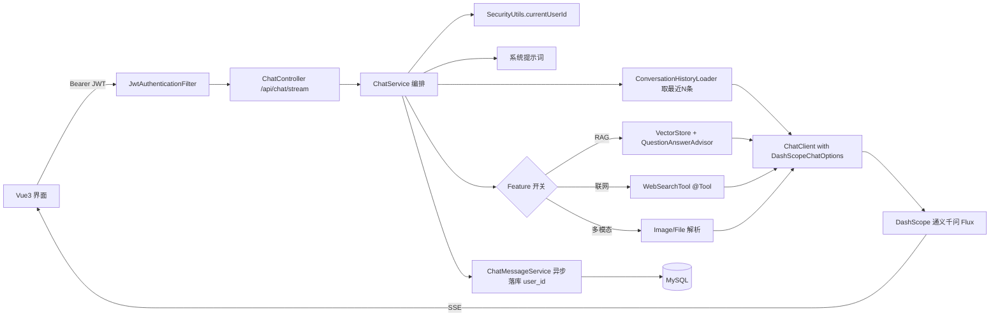
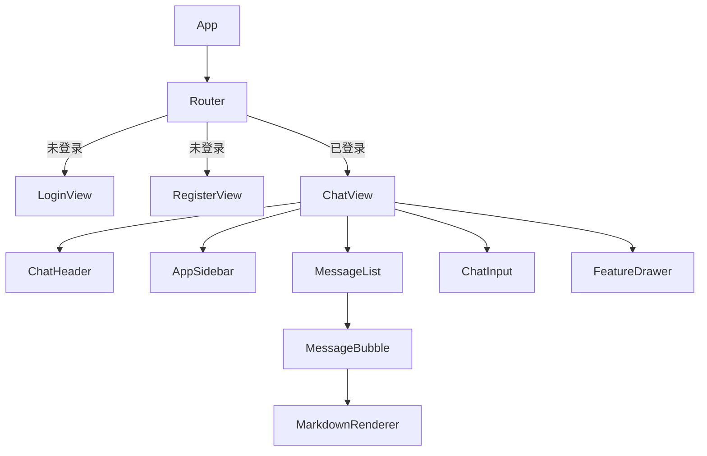

## 产品概述

从零搭建 **smart-query-system** 智能问答对话系统：后端 Spring Boot 3 + Spring AI Alibaba（DashScope 通义千问），前端 Vue3 + Element Plus 仿通义千问对话界面，SSE 流式打字机输出，MySQL + MyBatis-Plus 持久化会话与消息。

两项既定约束：

1. **前后端分离**：前端 `web/` 子目录内 Vite 独立构建（不走 Gradle），后端 Gradle 多模块；开发期走 Vite proxy，生产期前端静态资源独立部署。
2. **登录鉴权**：Spring Security + JWT，开放注册页，会话数据按 `user_id` 严格隔离。

并以「可开关、可无痛扩展」的方式预留四类进阶能力入口。

## 核心功能

1. **登录注册（新增）**

- 注册页：用户名 / 密码 / 确认密码，用户名唯一校验，密码 BCrypt 加密
- 登录页：账号密码登录，成功后返回 JWT；前端 Pinia 持久化用户信息，路由守卫拦截未登录访问
- Token 失效（401）自动跳转登录页；退出登录清理本地状态
- 所有 `/api/**`（除 `/api/auth/register`、`/api/auth/login`）需携带 `Authorization: Bearer <token>`

2. **对话主流程（必须具备）**

- 新建会话、发送消息、AI 流式（打字机）回复
- AI 回复支持 Markdown 渲染、代码块语法高亮、一键复制、重新生成
- 生成过程中可「停止生成」

3. **会话管理**

- 左侧会话列表，支持新建 / 重命名 / 删除 / 按标题搜索
- 切换会话回看完整历史消息，会话自动取首条提问作为标题
- **强制数据隔离**：所有会话与消息查询都带当前登录用户的 `userId` 条件

4. **多模型切换**

- 顶部下拉切换 qwen-plus / qwen-max / qwen-turbo 等，会话记忆当前所选模型

5. **预留能力入口（接口、配置、UI 开关具备，实现为可扩展桩）**

- 知识库 RAG：文档上传与向量检索增强回答
- 联网搜索：搜索工具增强实时性
- 文件 / 图片上传：多模态输入分析
- 每项能力以前端开关 + 后端 `FeatureType` 枚举 + 独立扩展包承载，默认关闭，不影响主链路

6. **基础体验**

- 深色 / 浅色主题切换、侧边栏折叠、响应式适配、悬浮提示与微交互动效

## 边界与约定

- DashScope API Key 通过环境变量注入，禁止硬编码进仓库
- JWT 密钥与过期时间走配置（`sqs.security.jwt.secret` / `expiration`），默认从环境变量 `SQS_JWT_SECRET` 读取并提供开发默认值
- 未做角色/权限体系，仅做「已登录用户」这一层；后续可扩展 `role` 字段

## 技术栈选型

| 层级 | 选型 | 说明 |
| --- | --- | --- |
| 构建 | Gradle 8.7 + Groovy DSL | 本机已装 8.7；多模块工程管理 |
| JDK | Java 21 Toolchain | 本机已装 `C:\Program Files\Java\jdk-21` |
| 后端 | Spring Boot 3.3.x + Spring AI 1.0.0 GA + Spring AI Alibaba 1.0.0.x | 用户指定 Spring AI Alibaba |
| 鉴权 | Spring Security 6 + JJWT 0.12.x | 用户选定；BCrypt 密码加密，无状态 Token |
| AI 模型 | DashScope 通义千问（qwen-plus / qwen-max / qwen-turbo / qwen-vl-max） | 通过 `spring-ai-alibaba-starter-dashscope` |
| ORM | MyBatis-Plus 3.5.7 | 用户选定，逻辑删除 + 自动填充 |
| 数据库 | MySQL 8 | 用户选定 |
| 前端 | Vue 3.4 + Vite 5 + Element Plus + Pinia + Vue Router 4 | 用户选定 Vue3 / Element Plus |
| Markdown | markdown-it + highlight.js + github-markdown-css + dompurify | AI 输出必须做 XSS 净化 |
| SSE | 原生 fetch + ReadableStream 解析 | EventSource 不支持 POST，需发送长 Prompt 与 JSON Body；需带 Authorization 头 |


> **版本风险与降级策略**：Spring AI / Spring AI Alibaba 处于快速迭代期，实施第一步必须先校验可用版本组合。首选 `spring-ai-alibaba-bom:1.0.0.x` + `spring-ai-bom:1.0.0` + Spring Boot 3.3.x；若解析失败，降级到官方示例已验证的 Boot 版本（3.2.x / 3.4.x），或用 `dependencies` 任务验证后再落地。

## 实施思路

**总体策略：单一数据源 + 分层多模块 + 能力可插拔 + 认证前置。**

1. **对话上下文不用 Spring AI 的 ChatMemory 双写**，而是每请求从 `chat_message` 表按 `session_id` **加 `user_id`** 取最近 N 条（默认 20，可配）构造 `List<Message>`。避免内存态与 DB 双源不一致，也避免重启丢上下文；单条带 LIMIT 的查询，无 N+1。会话消息上限通过 `SQS_CHAT_HISTORY_LIMIT` 控制 token 成本。
2. **多模型切换采用「单 ChatModel Bean + 每次请求覆盖 options」**，`ChatClient` 每次调用注入 `DashScopeChatOptions` 覆盖 `model`。若实测 Alibaba 版本未尊重 per-request options，则降级为 `ConcurrentHashMap.computeIfAbsent` 的懒加载 Model 注册表。
3. **SSE 流式**：Controller 返回 `Flux<String>`，`produces = MediaType.TEXT_EVENT_STREAM_VALUE`，由 ChatClient `.stream().content()` 驱动；结尾发送 `[DONE]` 哨兵，异常发送 `[ERROR]` 事件。
4. **认证链路**：`JwtAuthenticationFilter`（`OncePerRequestFilter`）在 `UsernamePasswordAuthenticationFilter` 之前解析 Bearer Token → 装载 `UserDetails` → 写入 `SecurityContextHolder`。Spring Security 6 用 `SecurityFilterChain` lambda 配置，`SessionCreationPolicy.STATELESS`，放行 `/api/auth/**`，其余 `.authenticated()`。当前登录用户通过统一入口 `SecurityUtils.currentUserId()` 获取，**禁止**信任前端传入的 userId。
5. **预留能力用「开关 + Advisor/Tool 插拔」**：系统提示词 → 历史消息 →（可选）QuestionAnswerAdvisor(RAG) →（可选）WebSearchTool → 模型调用。开关由前端 `features` 字段与后端 `FeatureType` 枚举共同驱动，默认全关。
6. **性能与安全**：向量库先用 Spring AI `SimpleVectorStore`（内存）并提供 `VectorStore` Bean 接缝；AI 输出经 DOMPurify 净化后再渲染到 DOM。

## 关键接口契约

```java
// ===== 认证 =====
// POST /api/auth/register  {username, password}          -> R<AuthVO>{token, userId, username}
// POST /api/auth/login     {username, password}          -> R<AuthVO>
// GET  /api/auth/me                                      -> R<UserVO>（需登录）
// 放行：/api/auth/register、/api/auth/login、/api/features（只读）、GET /actuator/health

// ===== 对话 =====
// POST /api/chat/stream  { sessionId, content, model, features } -> Flux<String>, text/event-stream
// 事件序列: data:{文本增量}\n\n ... data:[DONE]\n\n | data:[ERROR] {message}\n\n
// POST /api/chat（非流式，预留）                          -> R<ChatReplyVO>
// GET  /api/session                                      -> R<List<SessionVO>>（仅当前用户）
// POST /api/session                                      -> R<SessionVO>
// PATCH /api/session/{id}/title                          -> R<Void>
// DELETE /api/session/{id}                               -> R<Void>
// GET  /api/session/{id}/messages                        -> R<List<MessageVO>>
// GET  /api/features                                     -> R<List<FeatureVO>>
```

## 数据库表

- `sys_user`：id、username(唯一)、password(BCrypt)、nickname、avatar、status、create_time、update_time、deleted
- `chat_session`：id、**user_id(非空，索引)**、title、model、create_time、update_time、deleted
- `chat_message`：id、session_id、**user_id(冗余，便于统计)**、role、content、tokens、model、create_time、deleted

## 实施注意要点（防回归）

- **JDK 是本项目第一大坑**：默认 JAVA_HOME 为 JDK 8，在根 `gradle.properties` 写 `org.gradle.java.installations.paths=C:/Program Files/Java/jdk-21`，根 `build.gradle` 声明 `java { toolchain { languageVersion = JavaLanguageVersion.of(21) } }`。**不要**用 `org.gradle.java.home`。子模块不单独设 sourceCompatibility。
- **Gradle 多模块依赖方向**：`sqs-web → {sqs-ai, sqs-security}` → `sqs-core` → `sqs-common`，严格单向。只有 `sqs-web` 应用 `org.springframework.boot` 插件并产出 bootJar，其余用 `java-library`。版本统一在根 `dependencyManagement` 声明。
- **依赖冲突**：`sqs-security` 使用 `implementation` 引入 Spring Security，避免传递到其他模块污染。
- **SSE 与认证**：前端 fetch 流式请求必须手动带 `Authorization` 头（EventSource 无法带自定义头）。后端流式接口不可加统一响应包装。
- **SSE 超时与代理**：关闭网关缓冲；开发期 Vite proxy 需配置不缓冲 SSE（`changeOrigin` + 不加 `compress`）。
- **CORS 与 Vite 代理**：dev 走 Vite proxy `/api → localhost:8080`，后端同时配 CORS 兜底，允许 `Authorization` 头。
- **日志**：记录模型名、会话 ID、耗时与 token 消耗，**绝不打印完整 Prompt 正文、API Key 与 JWT**。
- **流式中断**：前端 `AbortController` 中断 fetch，后端 Flux 感知连接断开避免线程堆积。
- **鉴权严格隔离**：所有 `ChatSessionService` / `ChatMessageService` 方法签名接收 `userId`，从 `SecurityUtils` 取而非参数传入；越权访问返回 404 而非 403，避免会话 ID 枚举探测。

## 架构设计

### 后端分层调用链



### 前端组件树



## 目录结构

```
d:/learn-record/ai/smart-query-system/
├── settings.gradle                     # [NEW] sqs-common / sqs-core / sqs-ai / sqs-security / sqs-web
├── build.gradle                        # [NEW] 根工程：公共插件、dependencyManagement(BOM)、toolchain=21、UTF-8
├── gradle.properties                   # [NEW] jdk-21 installations、JVM 参数
├── .gitignore                          # [NEW] build/ node_modules/ *.local .env
├── README.md                           # [MODIFY] 启动步骤、JDK21 / API Key / MySQL / JWT 常见问题
├── sql/
│   └── schema.sql                      # [NEW] sys_user、chat_session、chat_message + 预置账号
├── sqs-common/
│   ├── result/R.java / ResultCode.java
│   ├── exception/BizException.java
│   └── enums/FeatureType.java
├── sqs-core/                           # entity / mapper / service / config / vo（含 SysUser）
├── sqs-security/                       # [NEW] 认证鉴权
│   ├── config/SecurityConfig.java      # SecurityFilterChain、放行规则、BCrypt Bean
│   ├── security/JwtTokenProvider.java  # 生成/解析/校验 JWT
│   ├── security/JwtAuthenticationFilter.java # OncePerRequestFilter 解析 Bearer
│   ├── security/SecurityUtils.java     # 当前登录 userId / username
│   ├── service/AuthService.java        # 注册、登录、校验
│   └── controller/AuthController.java  # /api/auth/**
├── sqs-ai/                             # ChatClient、ChatService、RAG、Tool、多模态、ModelRegistry
├── sqs-web/                            # 启动类、ChatController、SessionController、FeatureController、
│                                       # WebMvcConfig、全局异常处理、application.yml
└── web/                                # [NEW] Vue3 独立前端工程（Vite 独立构建，独立于 Gradle）
    ├── package.json / vite.config.js / index.html
    └── src/
        ├── main.js / App.vue
        ├── router/index.js             # 含路由守卫（未登录跳转 /login）
        ├── api/request.js              # axios 封装：自动注入 Token、401 拦截跳登录
        ├── api/auth.js / chat.js / session.js
        ├── utils/sse.js / markdown.js
        ├── stores/user.js / app.js / session.js / chat.js
        ├── views/LoginView.vue / RegisterView.vue / ChatView.vue / PlaceholderView.vue
        ├── components/layout/{AppSidebar,SessionList,ChatHeader}.vue
        ├── components/chat/{MessageList,MessageBubble,MarkdownRenderer,ChatInput}.vue
        ├── components/feature/FeaturePanel.vue
        └── styles/{index,variables,dark}.scss
```

## 设计风格

参照通义千问的「通透极简 + 紫蓝科技感」，采用 **Glassmorphism 辅助的 Minimalism**：大面积留白、克制的圆角与柔和阴影，品牌色为紫蓝渐变，侧栏使用半透明玻璃层，配合 fade-slide 与打字机微动效。登录/注册页使用左右分栏：左侧紫蓝渐变品牌区（含 Slogan 与动态光斑），右侧毛玻璃表单卡片。

## 页面规划

### 页面零：登录页 `/login`

- 左右分栏。左侧渐变品牌区：Logo「SmartQuery」、Slogan「智能问答，洞察每一条数据」、浮动光斑动画。
- 右侧毛玻璃卡片：标题「欢迎回来」、用户名/密码输入框（带前置图标、显示/隐藏密码）、「记住我」、渐变登录按钮（加载态）、底部「还没有账号？立即注册」跳转链接。
- 校验：字段为空/格式错误时输入框抖动 + 红色提示文案。

### 页面零-B：注册页 `/register`

- 同款分栏布局。表单：用户名（4-20 位字母数字下划线）、密码（至少 6 位，实时强度条）、确认密码（一致性校验）。
- 底部「已有账号？去登录」。

### 页面一：对话主页 `/chat/:id?`（核心，需登录）

- **Block 1 顶栏 ChatHeader**：左端 Logo；中部模型下拉；右端用户头像下拉（昵称 + 退出登录）、主题切换、预留功能入口。高度 56px，`backdrop-filter: blur(12px)`。
- **Block 2 会话侧栏 AppSidebar**：宽 260px 可折叠；顶部渐变「新建对话」按钮；中部搜索框；下方会话按「今天/更早」分组，选中项左侧渐变指示条，悬停出现重命名/删除图标。
- **Block 3 消息流 MessageList**：居中最大宽度 860px。空状态展示渐变标题与 3 个推荐「灵感提问」卡片；AI 消息左侧圆形渐变头像，用户消息右对齐浅紫气泡；等待时三点呼吸动画。
- **Block 4 输入区 ChatInput**：吸底，圆角 20px，自适应高度（最大 200px），Enter 发送 / Shift+Enter 换行，生成中切换为「停止」按钮。
- **Block 5 预留能力抽屉 FeatureDrawer**：知识库、联网搜索、多模态三个卡片式开关，含说明与「即将开放」标签。

### 页面二：功能占位页 `/knowledge` `/search` `/files`

- 顶部返回按钮 + 渐变标题；居中毛玻璃卡片，含线性图标、说明文案、「敬请期待」标签与返回按钮。

## 交互与动效

- 消息出现：Y 轴 12px 位移 + 透明度 0→1，200ms ease-out
- 打字机：流式增量追加，16ms 节流写入，光标 `▋` 闪烁，结束后淡出
- 表单校验失败：输入框 3px 左右抖动，300ms
- 自动滚动：新内容平滑滚底，用户手动上滚时暂停并浮出「回到最新」胶囊
- 统一 180–240ms cubic-bezier(0.4, 0, 0.2, 1)

## 响应式

- ≥1200px 侧栏全展开；900–1200px 侧栏收窄；<900px 侧栏转抽屉 + 遮罩，输入区吸底。登录/注册页 <900px 隐藏左侧品牌区，仅保留表单卡片。

## 使用的扩展

### SubAgent

- **code-explorer**：收尾阶段通读新建代码，核对 Gradle 依赖方向、包名引用、Bean 注入、鉴权注解与前后端接口路径一致性。

### Skill

- **playwright-cli**：启动后做冒烟验证（打开登录页 → 注册/登录 → 进入对话页 → 发一条消息 → 确认气泡与 Markdown 区域渲染、无控制台报错）。若未配置有效 API Key，以接口错误提示正常展示为通过判据，不做视觉走查。